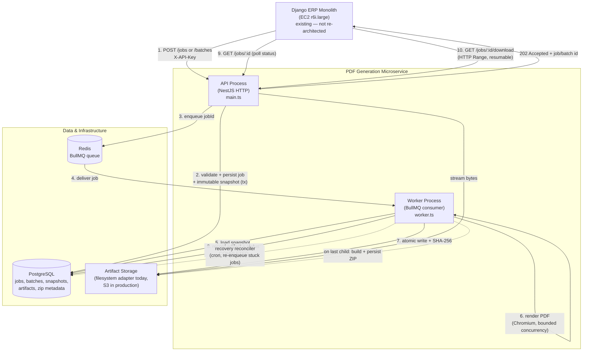
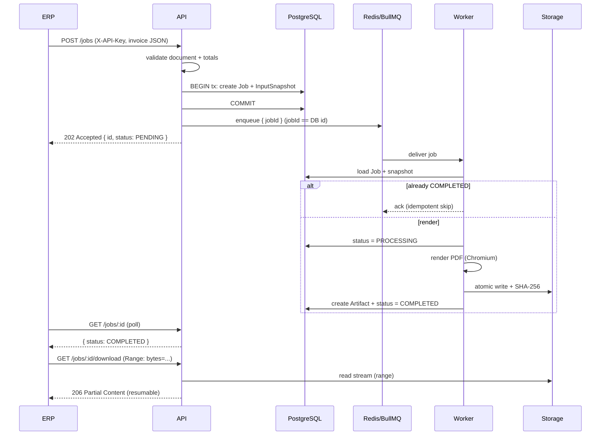
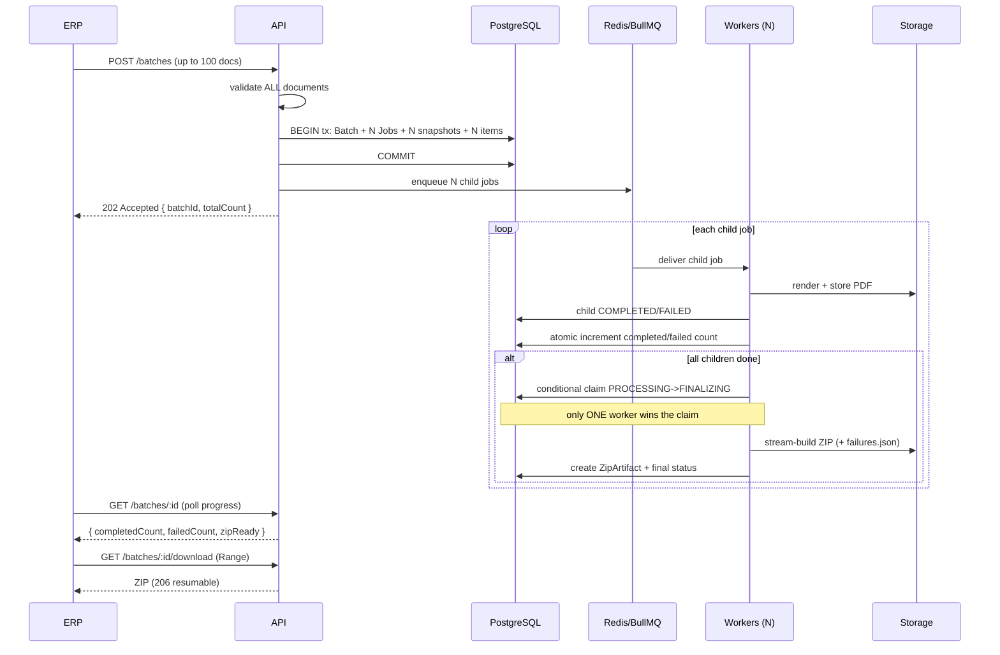
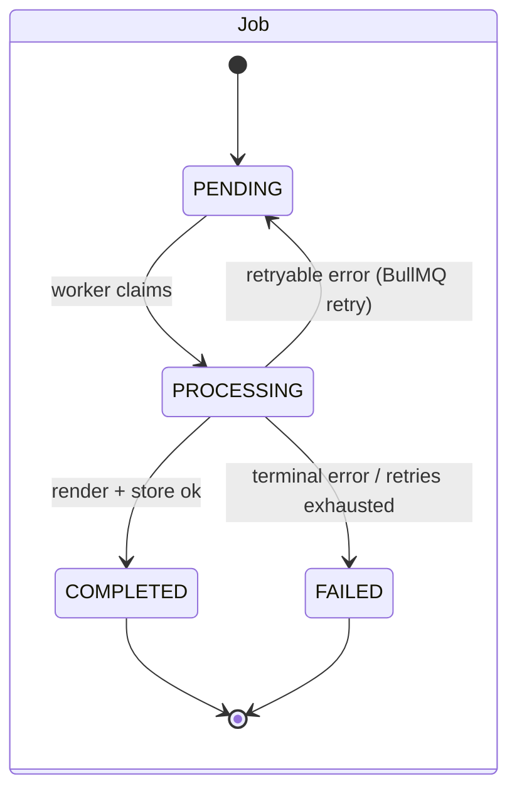
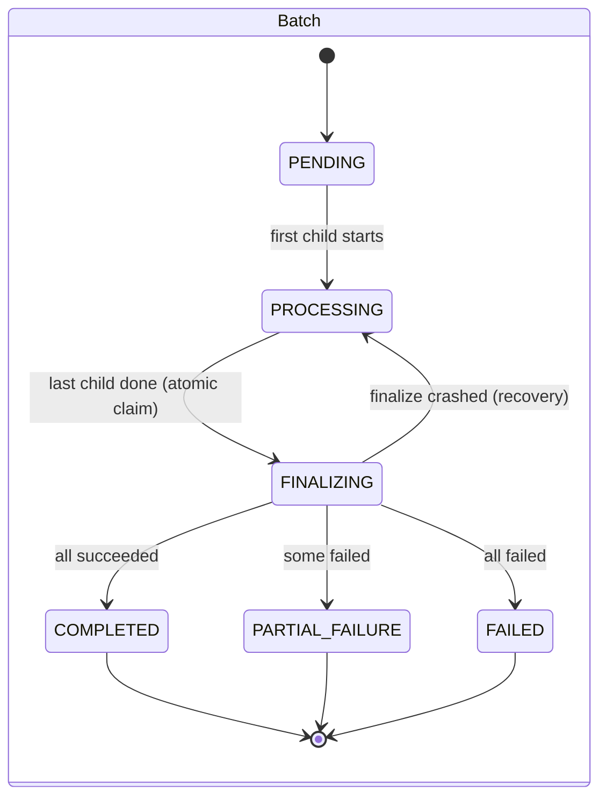

# Architecture

Mermaid source for the system architecture. GitHub renders this inline.
A rendered `architecture-diagram.png` is also committed at the repo root
for the assessment submission.

## System overview

## Single-document flow (async)

## Bulk batch flow with race-safe finalization

## Job & batch state machines

